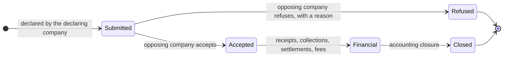
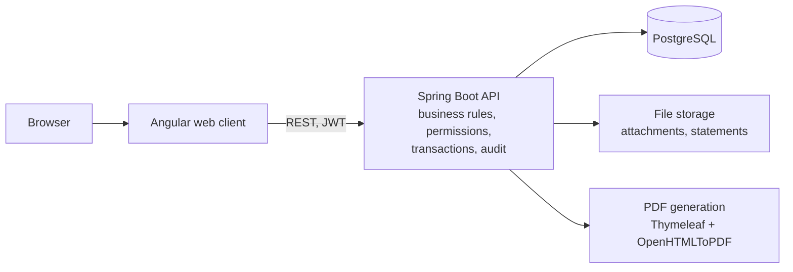

# Recourse clearing house: a case study

## Overview

This repository documents the design of a digital clearing house for inter-insurer recourse claims in the CIMA zone, the common insurance market regulated by the Conférence Interafricaine des Marchés d'Assurances. It summarises my final-year engineering thesis (Diplôme d'Ingénieur de Conception in computer engineering, École Supérieure Polytechnique, Université Cheikh Anta Diop de Dakar), supervised by Prof. Ibrahima Fall.

The system was built in an industrial setting. Its source code, its data and the names of the organisations involved are not public. This repository contains documentation only: no code, no data, no screenshots.

## Problem

When a loss involves policyholders of two insurers, the company that compensated its client (the declaring company) claims reimbursement from the company of the liable party (the opposing company). These recourse claims still circulate largely by letter, email and spreadsheet, followed by manual reconciliation. It is hard to know where a claim stands, who decided what, and how to attach the financial follow-up to the decision.

The design question is how to let competing companies process claims on one shared platform without any of them seeing data that does not concern it.

Actors:

- **Market organisation**: follows market-wide activity, maintains the company register, reads consolidated indicators and performs periodic closures.
- **Insurance company**: declares claims as declaring company and processes the claims it receives as opposing company.
- **Claims handler**: company user who declares, reviews, accepts or refuses claims within the rights of their profile.
- **Administrator**: manages reference data, users, profiles and permissions.

Insured persons appear in claims but do not log in.

Non-functional requirements: access restricted by permissions; confidentiality, each company seeing only the claims that concern it; traceability of sensitive actions; consistency between business decisions and financial processing (a refused claim never enters the financial circuit); and outputs (dashboards, statements) that match the recorded data exactly.

## Approach / Architecture

### Design principles

1. Business rules (statuses, access rights, processing conditions, financial effects) are enforced in the server-side business layer, never only in the browser.
2. Data is partitioned by company.
3. Declarations, decisions and financial operations are traced and remain readable afterwards.
4. A claim moves through a small number of explicit states.
5. Documents are generated from validated data only, never re-entered elsewhere.

### Claim lifecycle

A refused claim stays readable with its full history, so that the refusal can be understood later.

### Architecture

The application follows a three-tier, API-oriented architecture.

- The web client guides the claims handler. Every significant action goes to the API, which checks identity and scope before any update.
- Relational data lives in PostgreSQL. Attachments and generated statements live in separate file storage, so documentary evidence is not mixed with relational data.
- The web client, the API, the database and the file volumes are deployed with Docker as distinct blocks, with backups planned for important data. The interface or the services can therefore be updated without touching data or documents.

Functional modules: claim declaration and processing; messaging and attachments between companies; accounting follow-up (receipts, collections, settlements, management fees, closures); PDF statements; administration of companies, users and permissions; dashboards at company and market level.

### Security choices

- **Authentication** with JSON Web Tokens.
- **Role-based access control**: each user carries a profile whose permissions determine what they can view, create, modify or administer.
- **Data partitioning between companies**: each user is attached to one company. The claims a user can see are derived on the server from that attachment, not from the interface: a claim is visible to its declaring and opposing companies only. The market organisation has a consolidated view.
- **Audit trail**: declarations, decisions and financial operations are recorded with their history.
- **Decision–finance coupling**: only an accepted claim can lead to receipts and settlements.

## Tech stack

Java, Spring Boot, Spring Data JPA, PostgreSQL, Angular, TypeScript, JWT, Thymeleaf, OpenHTMLToPDF, Docker.

## How to run

Not applicable. This repository contains documentation only.

## Results and status

- A validation instance was deployed in a pre-production environment and checked across successive redeployments.
- The evaluation used a pre-populated database of 208 claims (105 accepted, 68 pending, 35 refused), with heterogeneous data.
- Functional test scenarios confirmed that:
  - issued and received claims can be viewed, searched and declared in one workspace;
  - a claim goes through its full lifecycle;
  - visibility depends on the company: two accounts from different companies, on the same screens, each see only their own claims;
  - an accepted claim is linked to its financial records;
  - dashboards give a reading per company and for the whole market.

**Limitations.** The system has not been used in production, and the evaluation consists of functional scenarios run by hand: it is not a load test, a security audit or an automated test suite. Before going live, monitoring, backups, incident management, automated testing and security hardening need to be strengthened.

**Next steps.** Extension to all companies in the market, tests on production data, and preparation for operation.

**Main lesson.** Understanding the domain (an issued versus a received claim, the effect of an acceptance or a refusal, the financial follow-up) was harder than the implementation, and it shaped the data model: the claim is the central object that links actors, evidence, decisions and money.

## License

This text is released under the [Creative Commons Attribution 4.0 International](https://creativecommons.org/licenses/by/4.0/) license.
